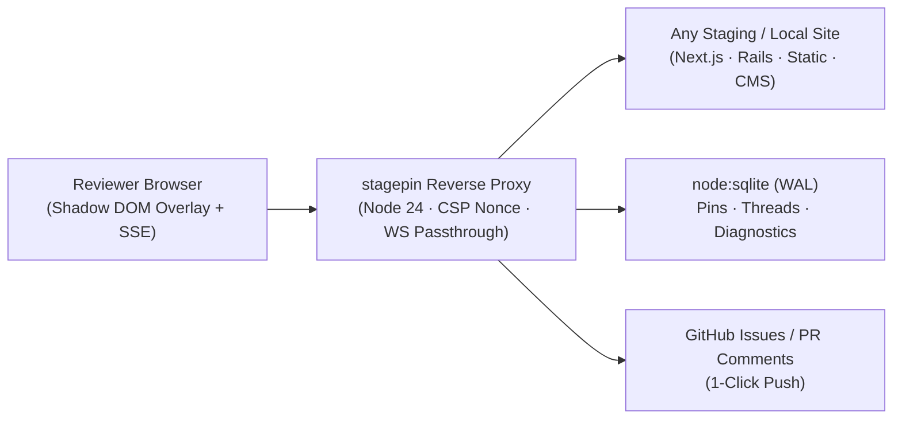

# stagepin

**Self-hosted Vercel Preview Comments for any website. Zero-code reverse proxy that injects a Shadow DOM visual feedback overlay, captures console and failed-network diagnostics, persists threads in SQLite, and pushes pins straight to GitHub Issues/PRs.**

[](./LICENSE)
[](https://nodejs.org)
[](#architecture)

[](https://github.com/flipcyde101/stagepin/releases/download/v0.1.0/stagepin-demo.mp4)

[Watch the 15-second stagepin demo (MP4)](https://github.com/flipcyde101/stagepin/releases/download/v0.1.0/stagepin-demo.mp4)

---

## Try It in 5 Seconds (Zero Setup)

```bash
npx stagepin --demo
```

Starts a local staging preview at `http://127.0.0.1:8080` with a pre-seeded misaligned pricing card, a broken `/api/checkout` (`HTTP 500`), and live Shadow DOM pins. Press **Alt+Click** (or click **Pin Mode**) on any element to drop a comment with captured diagnostics.

---

## Quick Start

```bash
# Proxy any local or staging website with zero code changes
npx stagepin --upstream http://localhost:3000 --port 8080

# Add a guest review password / magic link + 1-click GitHub PR comments
GITHUB_TOKEN=ghp_... npx stagepin \
  --upstream http://localhost:3000 \
  --password "client-review" \
  --github owner/repo#42
```

### 10-Line Self-Hosted Docker Sidecar (`docker-compose.yml`)

```yaml
services:
  stagepin:
    build: .
    ports:
      - "8080:8080"
    environment:
      STAGEPIN_UPSTREAM: http://host.docker.internal:3000
      STAGEPIN_PASSWORD: ""
      GITHUB_TOKEN: ""
    volumes:
      - stagepin_data:/data
volumes:
  stagepin_data:
```

### 1-Line `<script>` Fallback (Same-Origin Path Routing)

When routing `/__stagepin/` on the same origin behind Caddy, Nginx, or Traefik instead of reverse-proxying HTML:

```html
<script defer src="/__stagepin/overlay.js"></script>
```

---

## How `stagepin` Works

- **Zero CSS leakage:** Renders all pins, badges, and thread drawers inside a Shadow DOM root so host site styles never break the reviewer UI and Stagepin never alters your app's CSS.
- **Decompress + CSP-safe proxy:** Cleanly decompresses `gzip`, `br`, and `deflate` HTML before injecting the deferred overlay script, updates `Content-Security-Policy` with a per-response nonce without stripping your existing rules, and passes non-HTML assets and WebSocket/HMR upgrades through untouched.
- **Automatic bug diagnostics:** Captures CSS selector, anchor text, viewport dimensions, relative coordinates, and the last 20 `console.error` / `window.error` / failed `fetch` (`HTTP >= 400`) events on every pin.
- **Zero-account client reviews:** Pass `--password` to require a password or share a 1-click magic link (`/?stagepin_key=...`) stored in an `HttpOnly` `SameSite=Lax` cookie verified with `crypto.timingSafeEqual`.
- **SQLite WAL + Live SSE:** Uses Node 24's built-in `node:sqlite` (zero native addons) and broadcasts pin creations, replies, and resolves live via Server-Sent Events.

---

## Honest Comparison

| Feature | `stagepin` | Vercel Preview Comments | MarkUp.io / BugHerd / Pastel |
|---|---|---|---|
| **Self-hosted / MIT open source** | **Yes** (single Node 24 package / Docker) | No (Vercel lock-in) | No (proprietary SaaS) |
| **Per-seat pricing** | **Free** | Paid tiers | \$29-\$79+/seat/mo |
| **Zero app code changes (reverse proxy)** | **Yes** | Vercel deployments only | Proxy / extension |
| **Console & failed `fetch` diagnostics** | **Yes** | Partial | Paid tiers |
| **Where commercial tools win** | (Self-hosted simplicity & zero deps) | Deep native Vercel PR preview integration | Managed cloud hosting, video screen recordings, Jira/Linear enterprise sync |

---

## Architecture



## License

[MIT](./LICENSE)
